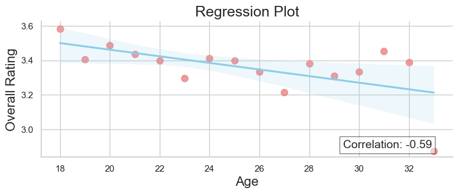

# Online Food Delivery Preferences – Bangalore (Swiggy)

<div dir="rtl">

**תקציר:** פרויקט קבוצתי בניתוח נתונים: ניתוח סקר של 388 לקוחות אפליקציות משלוחי אוכל באזור בנגלור (הודו) במחברת Jupyter. בדקנו מה משפיע על שביעות הרצון של הלקוחות, מי מזמין חטיפים ובאיזה אמצעי מזמינים, והצגנו את הממצאים בגרפים ובמפה.

</div>

---

## Overview

An exploratory data analysis project done as a team of three students for a university course. We analysed the public Kaggle survey [*Online Food Delivery Preferences – Bangalore region*](https://www.kaggle.com/datasets/benroshan/online-food-delivery-preferencesbangalore-region): 388 respondents and 55 columns covering demographics, location, how and what they order, and how they rate factors such as delivery time, payment, food quality and order mistakes. The notebook converts the survey answers to numbers, builds an overall satisfaction score, and explores three questions about customer satisfaction, snack orders and the preferred ordering channel, with Swiggy, an Indian food delivery app, as the example business. The notebook text is in Hebrew.

## What was done

1. **Data understanding** – structure, types, value counts, missing values (only `Reviews` has missing values, 0.26%), box plots of the numeric columns.
2. **Encoding** – Likert answers ("Strongly agree" … "Strongly disagree", "Very important" … "Unimportant") mapped to 1–5, with reversed scales for negative factors; yes/no, gender and wait time mapped to numbers.
3. **Overall rating** – a new column: the mean of 24 satisfaction-related survey items per respondent.
4. **Insight 1 – satisfaction drops with age.** Average overall rating per age, regression plot and correlation; then checks whether ordering channel, taste or meal type explain the drop, and which factors differ most between younger and older users.
5. **Insight 2 – snacks are ordered more than nutritious meals.** Snack orders by age group, gender, marital status and family size.
6. **Insight 3 – the app is the preferred channel.** Share of orders by channel, profile of app users, main pros and cons, and the share of customers who would order again.
7. **Map** – respondent locations on a Plotly geo scatter and a Folium map sized by order frequency per pin code.

## Tech stack

Python · Jupyter Notebook · pandas · NumPy · matplotlib · seaborn · SciPy (Pearson correlation) · Plotly · Folium

## Key findings

All numbers are from the notebook outputs.

- **388 respondents, 55 columns.** 301 (77.6%) said they would order again and 87 (22.4%) said they would not.
- **Older users are less satisfied.** The average overall rating per age falls from 3.58 at age 18 to below 3.0 at age 33. Correlation between age and the per-age average rating: **−0.59**.
- **Where the age gap is largest:** easy payment (a 2.0-point gap between ages), offers and discounts (1.9) and wrong orders delivered (1.9). The notebook suggests older customers care more about discounts and are less comfortable with mobile payment.
- **Ordering channel and taste do not explain the gap**: the share of each ordering channel and the taste rating look similar across ages.
- **Snacks:** the share of snack orders rises with family size, from 8% for one-person households to 59% for six-person households.
- **App users** say the main advantages are time saving and an easy payment option, and the main drawback is long delivery time.



## Repository structure

| File | Description |
|---|---|
| `1.ipynb` | The full analysis notebook (Hebrew text, charts and map) |
| `onlinedeliverydata.csv` | The survey dataset from Kaggle (388 rows) |
| `*.jpg`, `*.webp` | Illustration images shown in the notebook |
| `docs/age_vs_overall_rating.png` | Chart from the notebook |

## How to run

```bash
pip install pandas numpy matplotlib seaborn scipy plotly folium scikit-learn jupyter
jupyter notebook 1.ipynb
```

The notebook reads the CSV from this repository on GitHub, so it needs an internet connection. To run it offline, change the `url` in the loading cells to the local file `onlinedeliverydata.csv`.
